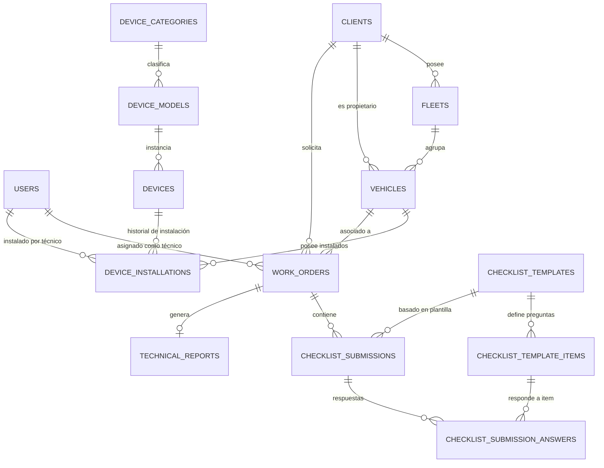

# 🚛 Fleet Tech API (Backend)

API RESTful empresarial de alto rendimiento para la gestión de operaciones técnicas en campo, control y trazabilidad de inventario de hardware telemático (GPS, MDVR, cámaras, sensores) y administración de checklists vehiculares dinámicos.

Este sistema actúa como núcleo central (Core API) para aplicaciones móviles (Flutter) utilizadas por técnicos en campo y plataformas web administrativas.

---

## 🛠️ Stack Tecnológico

| Componente | Tecnología | Detalle |
| :--- | :--- | :--- |
| **Lenguaje** | PHP 8.3+ | Tipado estricto (`declare(strict_types=1);`) |
| **Framework** | Laravel 12.x / 13.x | Arquitectura modular desacoplada |
| **Base de Datos** | PostgreSQL 16+ | Manejo relacional e indexación JSONB vía Eloquent ORM |
| **Autenticación** | Laravel Sanctum | Tokens seguros para API móvil y SPA Web |
| **Patrón Arquitectónico** | Domain-Driven Design (DDD) + ADR | Separación de dominios, DTOs y Actions |
| **Documentación API** | OpenAPI 3.0 / Swagger | Contratos de endpoints estandarizados |

---

## 🏛️ Arquitectura Domain-Driven Design (DDD)

Para garantizar mantenibilidad, aislamiento de la lógica de negocio y escalabilidad, el sistema organiza su lógica empresarial dentro del directorio `app/Domains/`, manteniendo el framework (`app/Http/`) como una capa de transporte/entrega (Delivery Mechanism).

### 📂 Estructura de Directorios Propuesta

```text
fleet-tech-api/
├── app/
│   ├── Domains/                               # Núcleo del Negocio (DDD)
│   │   ├── Shared/                            # Componentes transversales
│   │   │   ├── Enums/                         # Status genéricos, tipos comunes
│   │   │   ├── Traits/                        # HasUuid, Auditable, Filterable
│   │   │   └── ValueObjects/
│   │   │
│   │   ├── Fleet/                             # Dominio: Flota y Vehículos
│   │   │   ├── Actions/                       # CreateVehicleAction, AssignFleetAction
│   │   │   ├── DTOs/                          # VehicleData, FleetFilterData
│   │   │   ├── Enums/                         # VehicleType, VehicleStatus
│   │   │   ├── Events/                        # VehicleCreated, VehicleStatusChanged
│   │   │   ├── Exceptions/                    # DuplicatePlateException
│   │   │   └── Models/                        # Vehicle, Fleet, Client
│   │   │
│   │   ├── Inventory/                         # Dominio: Hardware y Trazabilidad
│   │   │   ├── Actions/                       # RegisterDeviceAction, InstallDeviceAction, UninstallDeviceAction
│   │   │   ├── DTOs/                          # DeviceData, DeviceInstallationData
│   │   │   ├── Enums/                         # DeviceStatus, DeviceCategoryEnum
│   │   │   ├── Events/                        # DeviceInstalled, DeviceDecommissioned
│   │   │   ├── Exceptions/                    # DeviceAlreadyInstalledException
│   │   │   └── Models/                        # Device, DeviceModel, DeviceCategory, DeviceInstallation
│   │   │
│   │   └── Operations/                        # Dominio: Operaciones en Campo
│   │       ├── Actions/                       # CreateWorkOrderAction, SubmitChecklistAction, GenerateTechnicalReportAction
│   │       ├── DTOs/                          # WorkOrderData, ChecklistSubmissionData
│   │       ├── Enums/                         # WorkOrderStatus, WorkOrderType, ChecklistItemType
│   │       ├── Events/                        # WorkOrderCompleted, ChecklistSubmitted
│   │       ├── Exceptions/                    # InvalidChecklistSubmissionException
│   │       └── Models/                        # WorkOrder, ChecklistTemplate, ChecklistTemplateItem, ChecklistSubmission, ChecklistSubmissionAnswer, TechnicalReport
│   │
│   ├── Http/                                  # Capa de Transporte / Entrega
│   │   ├── Controllers/
│   │   │   └── Api/
│   │   │       └── V1/
│   │   │           ├── Auth/                  # LoginController, ProfileController
│   │   │           ├── Fleet/                 # VehicleController, FleetController, ClientController
│   │   │           ├── Inventory/             # DeviceController, DeviceModelController, InstallationController
│   │   │           └── Operations/            # WorkOrderController, ChecklistController, TechnicalReportController
│   │   ├── Middleware/                        # Authenticate, CheckRole, ForceJsonResponse
│   │   ├── Requests/                          # FormRequests de Validación con Tipado Fuerte
│   │   │   ├── Api/V1/Fleet/
│   │   │   ├── Api/V1/Inventory/
│   │   │   └── Api/V1/Operations/
│   │   └── Resources/                         # API Resources (Estandarización JSON)
│   │       ├── Api/V1/Fleet/
│   │       ├── Api/V1/Inventory/
│   │       ├── Api/V1/Operations/
│   │       └── Api/V1/Shared/
│   │
│   └── Providers/                             # Service Providers de Laravel
│
├── database/
│   ├── factories/                             # Factories para pruebas
│   ├── migrations/                            # Esquema PostgreSQL
│   └── seeders/                               # Catálogos iniciales y datos de prueba
│
├── routes/
│   ├── api.php                                # Rutas API V1 agrupadas por dominio
│   └── console.php
└── tests/
    ├── Feature/                               # Tests de Integración End-to-End por Dominio
    └── Unit/                                  # Tests Unitarios de Actions y DTOs
```

---

## 🗄️ Esquema Inicial de Base de Datos (PostgreSQL)

### 📊 Diagrama Entidad-Relación (ERD)



---

### 📋 Definición de Tablas Principales por Dominio

#### 1. Usuarios y Clientes (Shared / Auth)
*   **`users`**: Administradores, supervisores y técnicos de campo.
    *   `id` (BIGSERIAL / UUID PK)
    *   `name` (VARCHAR), `email` (VARCHAR UNIQUE), `password` (VARCHAR)
    *   `role` (VARCHAR: `admin`, `supervisor`, `technician`)
    *   `phone` (VARCHAR nullable), `is_active` (BOOLEAN default true)
    *   `timestamps`
*   **`clients`**: Empresas o clientes propietarios de las flotas.
    *   `id` (BIGSERIAL / UUID PK)
    *   `code` (VARCHAR UNIQUE) - Ej. `CLI-001`
    *   `company_name` (VARCHAR), `tax_id` (VARCHAR UNIQUE - RUC/NIT/RFC)
    *   `contact_name` (VARCHAR), `contact_email` (VARCHAR), `contact_phone` (VARCHAR)
    *   `is_active` (BOOLEAN default true), `timestamps`

#### 2. Gestión Vehicular (Fleet Domain)
*   **`fleets`**: Agrupaciones lógicas de vehículos por cliente (ej: Flota Centro, Minería, Reparto).
    *   `id` (BIGSERIAL / UUID PK)
    *   `client_id` (FK `clients.id` ON DELETE CASCADE)
    *   `name` (VARCHAR), `description` (TEXT nullable), `is_active` (BOOLEAN)
    *   `timestamps`
*   **`vehicles`**: Padrón vehicular.
    *   `id` (BIGSERIAL / UUID PK)
    *   `client_id` (FK `clients.id` ON DELETE RESTRICT)
    *   `fleet_id` (FK `fleets.id` ON DELETE SET NULL, nullable)
    *   `plate_number` (VARCHAR(20) UNIQUE INDEX)
    *   `vin` (VARCHAR(50) UNIQUE nullable), `engine_number` (VARCHAR(50) nullable)
    *   `brand` (VARCHAR), `model` (VARCHAR), `year` (INT nullable)
    *   `vehicle_type` (VARCHAR: `truck`, `van`, `car`, `heavy_machinery`, `motorcycle`)
    *   `status` (VARCHAR: `active`, `maintenance`, `inactive`)
    *   `odometer` (NUMERIC(10,2) default 0)
    *   `timestamps`

#### 3. Inventario y Hardware (Inventory Domain)
*   **`device_categories`**: Clasificación (GPS, Cámara MDVR, Sensor de Combustible, Sensor de Fatiga, Botón de Pánico).
    *   `id` (SERIAL PK), `name` (VARCHAR), `code` (VARCHAR UNIQUE), `timestamps`
*   **`device_models`**: Modelos específicos de hardware (ej: Teltonika FMM130, Queclink GV300, Jimi JC400).
    *   `id` (SERIAL PK), `category_id` (FK `device_categories.id`)
    *   `brand` (VARCHAR), `model_name` (VARCHAR)
    *   `technical_specs` (JSONB) - Puertos, protocolos, sensores soportados
    *   `timestamps`
*   **`devices`**: Equipos físicos individuales con número de serie / IMEI.
    *   `id` (BIGSERIAL / UUID PK)
    *   `model_id` (FK `device_models.id`)
    *   `imei` (VARCHAR(30) UNIQUE nullable)
    *   `serial_number` (VARCHAR(50) UNIQUE)
    *   `sim_card_number` (VARCHAR(30) nullable)
    *   `sim_iccid` (VARCHAR(30) nullable)
    *   `status` (VARCHAR: `in_warehouse`, `assigned_to_technician`, `installed`, `maintenance`, `decommissioned`)
    *   `current_warehouse_location` (VARCHAR nullable)
    *   `assigned_technician_id` (FK `users.id` nullable)
    *   `current_vehicle_id` (FK `vehicles.id` nullable - acceso rápido con índice)
    *   `timestamps`
*   **`device_installations`**: Historial y trazabilidad de instalaciones/desinstalaciones.
    *   `id` (BIGSERIAL / UUID PK)
    *   `device_id` (FK `devices.id` ON DELETE CASCADE)
    *   `vehicle_id` (FK `vehicles.id` ON DELETE CASCADE)
    *   `work_order_id` (FK `work_orders.id` nullable)
    *   `installed_by_user_id` (FK `users.id`)
    *   `uninstalled_by_user_id` (FK `users.id` nullable)
    *   `status` (VARCHAR: `active`, `removed`, `replaced`)
    *   `installed_at` (TIMESTAMP), `uninstalled_at` (TIMESTAMP nullable)
    *   `installation_details` (JSONB) - Ubicación del equipo dentro de la cabina, accesorios conectados
    *   `notes` (TEXT nullable), `timestamps`

#### 4. Operaciones y Checklists (Operations Domain)
*   **`work_orders`**: Órdenes de trabajo asignadas a técnicos.
    *   `id` (BIGSERIAL / UUID PK)
    *   `order_number` (VARCHAR(30) UNIQUE INDEX) - Ej. `OT-2026-0001`
    *   `client_id` (FK `clients.id`)
    *   `vehicle_id` (FK `vehicles.id` nullable)
    *   `technician_id` (FK `users.id`)
    *   `order_type` (VARCHAR: `installation`, `maintenance`, `uninstallation`, `inspection`, `homologation`)
    *   `priority` (VARCHAR: `low`, `medium`, `high`, `urgent`)
    *   `status` (VARCHAR: `draft`, `scheduled`, `in_progress`, `completed`, `cancelled`)
    *   `scheduled_date` (TIMESTAMP), `started_at` (TIMESTAMP nullable), `completed_at` (TIMESTAMP nullable)
    *   `location_address` (VARCHAR nullable), `latitude` (DECIMAL(10,8) nullable), `longitude` (DECIMAL(11,8) nullable)
    *   `notes` (TEXT nullable), `timestamps`
*   **`checklist_templates`**: Formularios dinámicos configurables.
    *   `id` (SERIAL PK), `title` (VARCHAR), `version` (INT default 1)
    *   `type` (VARCHAR: `pre_installation`, `post_installation`, `vehicle_reception`, `maintenance`)
    *   `is_active` (BOOLEAN default true), `timestamps`
*   **`checklist_template_items`**: Preguntas/ítems de cada plantilla.
    *   `id` (SERIAL PK), `template_id` (FK `checklist_templates.id` ON DELETE CASCADE)
    *   `section_name` (VARCHAR) - Ej: "Estado Físico del Vehículo", "Instalación Eléctrica", "Pruebas de Transmisión"
    *   `label` (VARCHAR), `input_type` (VARCHAR: `boolean`, `select`, `text`, `number`, `photo`, `signature`)
    *   `is_required` (BOOLEAN default true)
    *   `options` (JSONB nullable) - Para campos tipo `select`
    *   `order_index` (INT default 0)
    *   `timestamps`
*   **`checklist_submissions`**: Respuestas completadas por el técnico en campo.
    *   `id` (BIGSERIAL / UUID PK)
    *   `work_order_id` (FK `work_orders.id` ON DELETE CASCADE)
    *   `template_id` (FK `checklist_templates.id`)
    *   `technician_id` (FK `users.id`)
    *   `vehicle_id` (FK `vehicles.id` nullable)
    *   `status` (VARCHAR: `in_progress`, `submitted`, `approved`, `rejected`)
    *   `signatures` (JSONB) - Firmas digitales en base64 o URLs S3 (técnico y encargado de flota)
    *   `geolocation` (JSONB) - Coordenadas al momento de envío
    *   `submitted_at` (TIMESTAMP nullable), `timestamps`
*   **`checklist_submission_answers`**: Detalle de respuesta por ítem.
    *   `id` (BIGSERIAL / UUID PK)
    *   `submission_id` (FK `checklist_submissions.id` ON DELETE CASCADE)
    *   `template_item_id` (FK `checklist_template_items.id`)
    *   `value` (TEXT nullable)
    *   `photo_urls` (JSONB nullable) - URLs de evidencias fotográficas adjuntas
    *   `status` (VARCHAR: `pass`, `fail`, `na`)
    *   `comments` (TEXT nullable), `timestamps`
*   **`technical_reports`**: Actas y constancias técnicas consolidadas.
    *   `id` (BIGSERIAL / UUID PK)
    *   `work_order_id` (FK `work_orders.id` UNIQUE)
    *   `report_code` (VARCHAR(30) UNIQUE INDEX)
    *   `summary` (TEXT), `diagnostics` (TEXT nullable), `actions_taken` (TEXT)
    *   `materials_used` (JSONB) - Cableado, fusibles, precintos, relés
    *   `client_signatory_name` (VARCHAR), `client_signatory_document` (VARCHAR)
    *   `pdf_path` (VARCHAR nullable) - Ruta del documento PDF generado
    *   `generated_at` (TIMESTAMP), `timestamps`

---

## 📦 Estándar de Respuesta API (API Response Envelope)

Todas las respuestas de la API siguen un formato predecible y unificado a través de **API Resources**:

### ✅ Respuesta Exitosa (200 / 201)
```json
{
  "success": true,
  "message": "Vehicle retrieved successfully",
  "data": {
    "id": 1,
    "plate_number": "ABC-123",
    "brand": "Volvo",
    "model": "FH 540",
    "year": 2024,
    "vehicle_type": "truck",
    "status": "active",
    "client": {
      "id": 10,
      "company_name": "Transportes San Martín S.A.C."
    },
    "current_installed_devices": [
      {
        "id": 5,
        "imei": "864201049281729",
        "model": "Teltonika FMM130",
        "category": "GPS",
        "installed_at": "2026-07-13T14:30:00Z"
      }
    ]
  },
  "meta": {
    "timestamp": "2026-09-23T09:15:00Z"
  }
}
```

### ❌ Respuesta de Error (422 / 400 / 404 / 500)
```json
{
  "success": false,
  "message": "The given data was invalid.",
  "errors": {
    "plate_number": [
      "The plate number has already been taken."
    ]
  },
  "meta": {
    "timestamp": "2026-09-23T09:15:00Z"
  }
}
```

---

## 🚀 Plan de Implementación por Fases

1. **Fase 1: Configuración Base y Autenticación**
   - Configuración de conexión PostgreSQL en `.env`.
   - Instalación y publicación de **Laravel Sanctum**.
   - Migración de `users` y `personal_access_tokens`.
   - Endpoints de autenticación (`/api/v1/auth/login`, `/logout`, `/me`) con API Resources.

2. **Fase 2: Dominio Fleet (Flotas y Vehículos)**
   - Migraciones: `clients`, `fleets`, `vehicles`.
   - Enums: `VehicleType`, `VehicleStatus`.
   - Actions: `CreateVehicleAction`, `UpdateVehicleAction`.
   - Controllers y FormRequests tipados con reglas de validación (patrón de placa, unicidad).

3. **Fase 3: Dominio Inventory (Equipos y Trazabilidad)**
   - Migraciones: `device_categories`, `device_models`, `devices`, `device_installations`.
   - Actions para asignación de equipos a técnicos y vinculación/desvinculación a vehículos.
   - Historial de trazabilidad (auditoría de cada cambio de estado de hardware).

4. **Fase 4: Dominio Operations (Órdenes de Trabajo y Checklists Dinámicos)**
   - Migraciones: `work_orders`, `checklist_templates`, `checklist_template_items`, `checklist_submissions`, `checklist_submission_answers`, `technical_reports`.
   - Motor dinámico para renderizar y validar checklists según tipo de entrada (`boolean`, `photo`, `signature`, `options`).
   - Generación de reportes técnicos con firma y exportación PDF.
